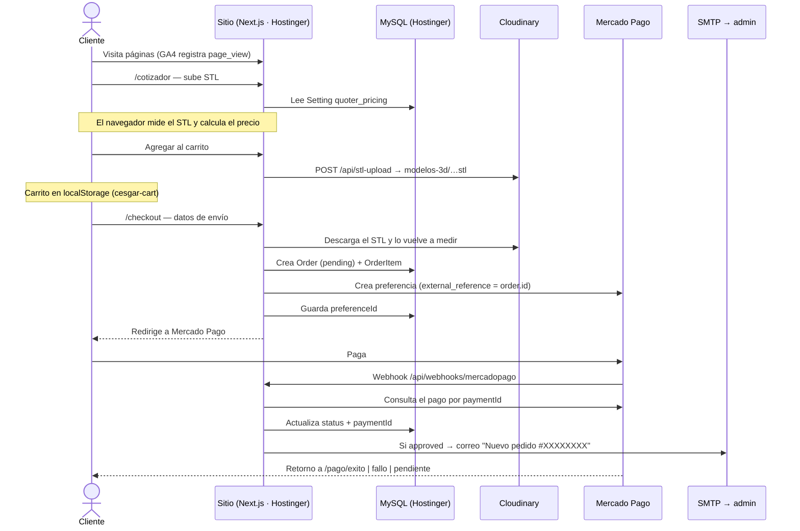

# Estudio de trazabilidad — Flujo del cliente del cotizador 3D

Fecha: 2026-10-01.

Objetivo: describir el recorrido de un cliente desde que entra al sitio hasta que
compra una impresión 3D cotizada, qué información se genera en cada paso, en qué
sistema queda guardada y qué identificadores permiten seguir un pedido de punta
a punta.

---

## III.4. Tecnologías

### III.4.1. Lenguajes de Programación

| Lenguaje | Uso en el proyecto |
|---|---|
| **TypeScript 5** | Toda la aplicación: páginas, componentes, endpoints de API, server actions, lógica de precios y envíos (`app/`, `lib/`), y scripts de verificación |
| **JavaScript (ES Modules)** | Scripts de build y mantenimiento (`scripts/*.mjs`, `scripts/prisma-setup.js`) y algunos componentes visuales (`.jsx`) |
| **SQL** | Migraciones de Prisma (`prisma/migrations/`) y carga inicial de producción (`seed-production.sql`) |
| **HTML / JSX** | Vistas en React y plantillas HTML de los correos (`lib/mailer.ts`) |
| **CSS** | Estilos con Tailwind CSS y hoja global (`app/globals.css`) |
| **Python** | Exportación de artículos y proyectos a Markdown (`articulos-exportados/_exportar.py`) |

### III.4.2. Frameworks / Librerías

**Núcleo de la aplicación**

| Tecnología | Versión | Uso |
|---|---|---|
| **Next.js** | 16.2.3 | Framework web: App Router, Route Handlers (`app/api/`), Server Actions, `proxy.ts` para proteger `/admin`, build `standalone` con Turbopack |
| **React** | 19.2.4 | Interfaz de usuario |
| **Prisma ORM** | 6.19.3 | Acceso a datos y esquema de la base (`prisma/schema.prisma`, `prisma/schema.production.prisma`) |
| **Zod** | 4 | Validación de los formularios de cotización y servicios en server actions |

**Interfaz, estilos y animación**

| Tecnología | Versión | Uso |
|---|---|---|
| **Tailwind CSS** | 4 | Estilos; con `@tailwindcss/typography` y `tw-animate-css` |
| **shadcn / Radix UI** | 4 / 1.4 | Componentes accesibles base |
| **Headless UI** | 2.2 | Carrito lateral (`Dialog`) y menú móvil (`Disclosure`) |
| **class-variance-authority, clsx, tailwind-merge** | — | Composición de clases CSS |
| **Three.js** | 0.184 | Visor 3D de los modelos STL en el cotizador y en la sección Modelos del panel (`/admin/modelos`) |
| **GSAP** (+ `@gsap/react`) | 3.15 | Animaciones |
| **Framer Motion / Motion** | 12 | Animaciones de componentes |
| **Lenis** | 1.3 | Desplazamiento suave |
| **Lucide React, Heroicons** | — | Iconografía |
| **TipTap** | 3.22 | Editor enriquecido del blog y proyectos (imágenes, enlaces, YouTube, resaltado, alineación) |

**Integraciones y seguridad**

| Tecnología | Versión | Uso |
|---|---|---|
| **SDK Mercado Pago** (`mercadopago`) | 2.12 | Creación de preferencias y consulta de pagos (`lib/mercadopago.ts`) |
| **SDK Cloudinary** (`cloudinary`) | 2.10 | Subida de STL, imágenes y videos (`lib/cloudinary.ts`) |
| **Nodemailer** | 8 | Envío de correos por SMTP (`lib/mailer.ts`) |
| **jose** | 6 | Sesiones JWT en cookie para el panel de administración (`lib/session.ts`) |
| **bcryptjs** | 3 | Hash de contraseñas de los usuarios del panel |
| **server-only, dotenv** | — | Aislamiento de código de servidor y carga de variables de entorno |

**Herramientas de desarrollo**

| Tecnología | Uso |
|---|---|
| **ESLint 9** + `eslint-config-next` | Análisis estático |
| **ts-node** | Scripts de verificación (`npm run verify:cotizador`, `verify:envios`, `verify:youtube`) y seed |
| **csv-parse** | Importación del catálogo exportado desde WooCommerce (`scripts/import-wc-products.ts`) |

### III.4.3. Bases de Datos

| Motor / almacén | Entorno | Uso |
|---|---|---|
| **MySQL** | Producción (Hostinger) | Base principal: productos, órdenes, ítems, solicitudes, blog, proyectos, usuarios y configuración. Esquema en `prisma/schema.production.prisma` |
| **SQLite** | Desarrollo local | Misma estructura en `prisma/dev.db`, esquema en `prisma/schema.prisma` |
| **Tabla `Setting`** | Ambos | Almacén clave–valor en JSON para la configuración editable desde el panel (`quoter_pricing`, `shipping_config`) |
| **`localStorage`** | Navegador del cliente | Carrito de compras (`cesgar-cart`) |

El build (`npm run build`) ejecuta `scripts/verificar-schemas.mjs` para comprobar
que los dos esquemas de Prisma estén alineados y `scripts/prisma-setup.js --push`
para elegir el esquema según `DATABASE_URL` (`mysql://` → producción) y
sincronizar la base.

### III.4.4. Plataformas Cloud / Infraestructura

| Plataforma | Uso |
|---|---|
| **Hostinger** | Hosting de la aplicación Node.js (build `standalone`), base de datos MySQL y dominio `cesgar.com.co` |
| **Cloudinary** | Almacenamiento y CDN de archivos: STL de clientes (`modelos-3d/`), referencias de cotizaciones (`cotizaciones/`), imágenes y videos de productos, blog y proyectos |
| **Mercado Pago** | Pasarela de pagos (Checkout Pro): preferencias, redirección al pago y notificaciones por webhook |
| **Gmail (SMTP)** | Servidor de correo saliente para las notificaciones al administrador |
| **Google Analytics 4** | Medición de tráfico (`G-KMCFP3WBX5`) |
| **GitHub** | Repositorio de código: `github.com/YonyChaparro/ecommerce-cesgar` |
| **YouTube** (`youtube-nocookie.com`) | Videos embebidos en artículos y proyectos |
| **Google Fonts** | Tipografía Geist, servida por `next/font` |

### III.4.5. Otras Tecnologías Relevantes

| Tecnología | Uso |
|---|---|
| **WhatsApp** | Canal directo de comunicación con el cliente: [https://wa.me/573057956352](https://wa.me/573057956352) (+57 305 795 6352). Botón presente en las páginas de servicios |
| **Formato STL** | Archivo de entrada del cotizador; medición de volumen con un parser propio que separa cuerpos y cavidades (`lib/stl-parse.ts`) |
| **Webhooks HTTP** | Recepción de notificaciones de pago de Mercado Pago (`/api/webhooks/mercadopago`) |
| **JWT + cookies** | Autenticación del panel de administración |
| **Variables de entorno** | Credenciales de base de datos, Mercado Pago, Cloudinary y SMTP (`DATABASE_URL`, `MP_ACCESS_TOKEN`, `CLOUDINARY_*`, `SMTP_*`, `NEXT_PUBLIC_APP_URL`) |
| **SEO técnico** | Datos estructurados JSON-LD de schema.org (`LocalBusiness`, `BreadcrumbList`), metadatos Open Graph y `sitemap.xml` dinámico (`app/sitemap.ts`) |
| **Redes sociales** | Instagram ([@cesgar_co](https://www.instagram.com/cesgar_co/)) y [Facebook](https://www.facebook.com/profile.php?id=61553397902949), enlazadas en el pie de página |
| **WooCommerce (CSV)** | Origen del catálogo de productos migrado a la tienda actual |

---

## 1. Resumen

El cliente navega sin cuenta. Mientras cotiza, todo ocurre en su navegador; la
primera huella en servidor es el archivo STL que se sube a Cloudinary al
agregarlo al carrito, y la traza formal nace en el checkout, cuando se crea la
`Order` en MySQL. Desde ahí, el `id` de la orden viaja a Mercado Pago como
`external_reference` y es la llave que une base de datos, pasarela, archivos y
correos.

---

## 2. Identificadores que unen la traza

| Identificador | Dónde se origina | Dónde aparece | Para qué sirve |
|---|---|---|---|
| `cotizador-<id>` | Navegador, al agregar al carrito | `localStorage` y el cuerpo de `POST /api/checkout` | Distingue un ítem del cotizador de un producto de la tienda |
| `modelUrl` | Cloudinary, al subir el STL | `OrderItem.modelUrl` | Enlaza la línea del pedido con el archivo exacto que se imprimirá |
| `Order.id` (cuid) | MySQL, en el checkout | `Order.id`, `external_reference` en Mercado Pago, URL del panel `/admin/orders/<id>` | **Llave principal de la traza** |
| `#XXXXXXXX` | Últimos 8 caracteres de `Order.id` en mayúsculas | Asunto del correo de nuevo pedido | Referencia corta para comunicarse con el cliente |
| `preferenceId` | Mercado Pago, al crear la preferencia | `Order.preferenceId` | Une la orden con la sesión de pago creada |
| `paymentId` | Mercado Pago, al procesar el pago | `Order.paymentId` | Une la orden con el cobro real en el panel de Mercado Pago |

---

## 3. Flujo paso a paso

### 3.1 Ingreso y navegación

- **Qué hace el cliente:** recorre inicio, tienda, servicios, proyectos o blog.
- **Qué se registra:** Google Analytics 4 (`G-KMCFP3WBX5`) carga en todas las
  páginas desde `app/layout.tsx` y registra las vistas de página.
- **Dónde queda:** Google Analytics.

### 3.2 Cotización en `/cotizador`

- **Qué hace el cliente:** sube uno o varios archivos `.stl` y elige
  tecnología (FDM/resina), material, color, altura de capa, relleno, escala,
  post-procesado y cantidad.
- **Qué pasa en el sistema:**
  - La página lee la tabla de precios que configura el admin desde
    `Setting` (`key: 'quoter_pricing'`) mediante `lib/quoter-config.ts`.
  - El navegador analiza la malla (`lib/stl-parse.ts`), calcula volumen, peso,
    tiempo y precio (`lib/quoter-calc.ts`, `lib/quoter-rules.ts`) y lo muestra
    al instante.
- **Dónde queda:** en memoria del navegador.

Si el modelo no se puede medir con fiabilidad o excede el tamaño máximo de una
pieza, el cotizador no permite agregarlo al carrito y dirige al formulario de
cotización personalizada (ver sección 4).

### 3.3 Agregar al carrito

- **Qué hace el cliente:** pulsa "Agregar al carrito".
- **Qué pasa en el sistema** (`app/components/Quoter.tsx`):
  1. Cada STL se envía a `POST /api/stl-upload`, que lo sube a Cloudinary como
     archivo *raw* en `ecommerce-cesgar/modelos-3d/<timestamp>-<nombre>.stl` y
     devuelve su `secure_url` (`modelUrl`).
  2. Se arma el ítem del carrito con:
     - `id`: `cotizador-<id>`
     - `name`: nombre del archivo sin extensión
     - `price`: precio unitario calculado en el navegador
     - `note`: resumen legible, p. ej.
       `FDM · PLA · Negro · 0.2mm · 20% relleno · 40.0×30.0×10.0mm · ~12.3g/u · ~1.5h/u · Sin post-proc.`
     - `modelUrl`: URL del STL en Cloudinary
     - `printConfig`: elecciones de impresión y medidas de la malla
- **Dónde queda:**
  - El archivo STL → **Cloudinary**.
  - El carrito → `localStorage` del navegador, clave `cesgar-cart`
    (`app/components/CartContext.tsx`).

### 3.4 Checkout en `/checkout`

- **Qué hace el cliente:** llena nombre, email, tipo y número de documento,
  teléfono, dirección, barrio, departamento, ciudad, código postal e
  instrucciones; elige entrega a domicilio o recogida en punto.
- **Qué pasa en el navegador:** consulta `GET /api/shipping-config` para
  mostrar el costo de envío y luego envía `POST /api/checkout` con los ítems,
  los datos de envío, el método de entrega y el costo de envío mostrado.
- **Qué pasa en el servidor** (`app/api/checkout/route.ts`):
  1. **Verificación del cotizador** (`lib/quoter-verify.ts`): solo acepta
     `modelUrl` de la carpeta propia `modelos-3d` en Cloudinary, descarga el
     STL, lo vuelve a medir y recalcula el precio con la tabla del admin. El
     precio que manda el navegador solo se compara para dejar registro en el
     log si difiere.
  2. **Productos de tienda**: valida existencia y stock contra `Product`.
  3. **Envío**: calcula el costo con la configuración de `Setting`
     (`key: 'shipping_config'`) mediante `lib/shipping-calc.ts`. Si difiere del
     que vio el cliente, responde 409 con el nuevo total para que lo confirme.
  4. **Crea la orden** en MySQL:
     - `Order`: `status: 'pending'`, `type` (`product` | `cotizador` | `mixed`),
       `subtotal`, `shippingCost`, `shippingMethod`, `total` y todos los campos
       `shipping*` del formulario.
     - `OrderItem` por cada línea: `itemType`, `name`, `price` (verificado por
       el servidor), `quantity`, `note`, `modelUrl` (cotizador) o `productId`,
       `slug`, `category` (tienda).
  5. **Crea la preferencia en Mercado Pago** con los ítems, el envío (como
     `shipments` o como línea adicional, según `modoPasarela`), los datos del
     pagador, `back_urls`, `notification_url` y
     `external_reference = order.id`. Si Mercado Pago falla, borra la orden y
     responde 502.
  6. Guarda `preferenceId` en la orden y escribe en el log
     `[checkout] preferencia creada →` con orden, preferencia, montos y URLs.
  7. Devuelve la URL de pago; el navegador vacía el carrito y redirige.
- **Dónde queda:** **MySQL** (`Order`, `OrderItem`), **Mercado Pago**
  (preferencia y datos del pagador) y el **log del proceso Node** en Hostinger.

### 3.5 Pago en Mercado Pago

- **Qué hace el cliente:** paga con el medio que elija en el checkout de
  Mercado Pago.
- **Dónde queda:** **Mercado Pago** (transacción, medio de pago, comprobante al
  comprador). Los datos de pago no pasan por el sitio.

### 3.6 Notificación del pago (webhook)

- **Endpoint:** `POST /api/webhooks/mercadopago`
  (`app/api/webhooks/mercadopago/route.ts`).
- **Qué pasa:**
  1. Lee `type`/`data.id` del cuerpo o `topic`/`id` de la query (formato IPN).
  2. Consulta el pago a la API de Mercado Pago con ese `paymentId` (así el
     estado viene de Mercado Pago y no del cuerpo recibido).
  3. Toma `external_reference` del pago, traduce el estado (ver sección 5) y
     actualiza `Order.status` y `Order.paymentId`.
  4. Si el estado es `approved`, envía el correo "🛒 Nuevo pedido
     #XXXXXXXX — $total COP" con ítems, notas, desglose de subtotal y envío,
     datos de envío y enlace al panel (`lib/mailer.ts`, `sendNewOrderEmail`).
  5. Escribe en el log `[webhook/mp] recibido`, `[webhook/mp] pago` y
     `[webhook/mp] orden actualizada`.
- **Dónde queda:** **MySQL** (estado y `paymentId`), **buzón del admin**
  (`cesangarciar@gmail.com`) y **log del proceso Node**.

### 3.7 Regreso al sitio

Mercado Pago devuelve al cliente a `/pago/exito`, `/pago/fallo` o
`/pago/pendiente` según el resultado. En producción el regreso es automático
cuando el pago queda aprobado (`auto_return: 'approved'`).

### 3.8 Gestión en el panel

- `/admin/orders` lista las órdenes; `/admin/orders/<id>` muestra el detalle,
  los datos de envío, el desglose, el botón "Descargar modelo STL" de cada
  ítem del cotizador (`modelUrl`) y los identificadores `ID orden`,
  `ID preferencia MP` e `ID pago MP`.
- El admin puede cambiar el estado manualmente entre `pending`, `approved`,
  `in_process`, `rejected` y `cancelled` (`app/admin/(panel)/orders/actions.ts`).
- El acceso al panel está protegido por sesión (`proxy.ts`, `lib/session.ts`).

---

## 4. Vía alterna: cotización personalizada y solicitudes de servicio

### 4.1 Cotización personalizada (`/cotizador#cotizacion-personalizada`)

- **Cuándo se usa:** piezas que el cotizador automático no puede tarifar o
  cuando el cliente prefiere una cotización a medida.
- **Qué envía el cliente:** nombre, email, teléfono/WhatsApp, tipo de
  servicio, descripción, archivos STL e imágenes o videos de referencia.
- **Qué pasa en el sistema:**
  - STL → `POST /api/stl-upload` → Cloudinary `modelos-3d/`.
  - Imágenes y videos → `POST /api/inquiries/upload` → Cloudinary
    `cotizaciones/`.
  - Server action `submitQuoteRequest` (`app/cotizador/actions.ts`) crea un
    `ServiceInquiry` con `service: 'cotizador-personalizado'` y en `extra` un
    JSON con el tipo de servicio y las URLs de los archivos.
  - Correo "📐 Cotización personalizada: \<servicio\> — \<nombre\>" al admin.
- **Dónde queda:** **MySQL** (`ServiceInquiry`), **Cloudinary** (archivos) y
  **buzón del admin**.

### 4.2 Solicitudes desde las páginas de servicios

Los formularios de `/servicios/*` (diseño 3D, escaneo 3D, prototipado,
repuestos) usan `submitServiceInquiry` (`app/servicios/actions.ts`): crean un
`ServiceInquiry` con el `service` correspondiente, guardan los campos
específicos del formulario en `extra` y envían el correo "📋 Nueva solicitud".
Estas páginas también ofrecen contacto directo por WhatsApp
([https://wa.me/573057956352](https://wa.me/573057956352)).

---

## 5. Estados de la orden

| Estado en Mercado Pago | `Order.status` |
|---|---|
| `approved` | `approved` |
| `pending` | `pending` |
| `in_process` | `in_process` |
| `authorized` | `in_process` |
| `rejected` | `rejected` |
| `cancelled` | `cancelled` |
| `refunded` | `rejected` |
| `charged_back` | `rejected` |
| otro | `pending` |

Ciclo típico: la orden nace `pending` en el checkout → el webhook la mueve al
estado que reporte Mercado Pago → el admin puede ajustarla desde el panel.

---

## 6. Aplicaciones externas

| Servicio | Rol | Información que guarda | Configuración |
|---|---|---|---|
| **Hostinger** (Node.js + MySQL) | Aloja la aplicación y la base de datos | `Order`, `OrderItem`, `ServiceInquiry`, `Setting`, `Product`; log de consola del proceso | `DATABASE_URL` |
| **Cloudinary** | Almacenamiento de archivos | STL de clientes (`modelos-3d/`), referencias de cotizaciones (`cotizaciones/`), media de productos, blog y proyectos | `CLOUDINARY_CLOUD_NAME`, `CLOUDINARY_API_KEY`, `CLOUDINARY_API_SECRET`, `CLOUDINARY_FOLDER` |
| **Mercado Pago** | Pasarela de pago | Preferencias, pagos, datos del pagador, comprobantes | `MP_ACCESS_TOKEN`, `NEXT_PUBLIC_APP_URL` (back URLs y webhook) |
| **SMTP** (Gmail por defecto) vía nodemailer | Notificaciones al admin | Correos de nuevo pedido, cotización personalizada y solicitud de servicio en `cesangarciar@gmail.com` | `SMTP_HOST`, `SMTP_PORT`, `SMTP_USER`, `SMTP_PASS` |
| **Google Analytics 4** | Analítica web | Vistas de página | ID `G-KMCFP3WBX5` en `app/layout.tsx` |
| **WhatsApp** | Contacto directo | Conversaciones con el cliente | [https://wa.me/573057956352](https://wa.me/573057956352) en páginas de servicios |

---

## 7. Mapa de almacenamiento

| Dato | Sistema | Ubicación |
|---|---|---|
| Tabla de precios del cotizador | MySQL | `Setting` · `quoter_pricing` |
| Configuración de envíos | MySQL | `Setting` · `shipping_config` |
| Carrito | Navegador del cliente | `localStorage` · `cesgar-cart` |
| Archivo STL del pedido | Cloudinary | `ecommerce-cesgar/modelos-3d/` |
| Imágenes/videos de cotización personalizada | Cloudinary | `ecommerce-cesgar/cotizaciones/` |
| Datos del comprador y dirección | MySQL + Mercado Pago | `Order.shipping*` · `payer` de la preferencia |
| Líneas del pedido, precio verificado, nota de impresión | MySQL | `OrderItem` |
| Totales y envío | MySQL | `Order.subtotal`, `shippingCost`, `shippingMethod`, `total` |
| Estado del pago | MySQL + Mercado Pago | `Order.status`, `Order.paymentId` |
| Transacción y comprobante | Mercado Pago | Panel de Mercado Pago |
| Solicitudes de cotización/servicio | MySQL | `ServiceInquiry` (`extra` en JSON) |
| Notificaciones | Buzón del admin | `cesangarciar@gmail.com` |
| Eventos del checkout y webhook | Hostinger | Log del proceso Node (`[checkout]`, `[webhook/mp]`, `[mailer]`) |
| Navegación | Google Analytics | Propiedad `G-KMCFP3WBX5` |

---

## 8. Cómo rastrear un pedido

**Desde el correo (`#XXXXXXXX`):** el correo trae el enlace
`/admin/orders/<id>`; ahí están cliente, ítems, envío, estado, `paymentId` y
los STL.

**Desde Mercado Pago:** en el detalle del pago, la *referencia externa* es el
`Order.id`; con ella se abre `/admin/orders/<id>`.

**Desde la orden hacia el archivo:** cada `OrderItem` del cotizador tiene
`modelUrl`, la URL del STL exacto en Cloudinary que se midió para cobrar.

**Desde la orden hacia el pago:** `Order.paymentId` es el número de operación
en Mercado Pago; `Order.preferenceId` identifica la preferencia.

**Desde los logs:** buscar el `orderId` o el `paymentId` en el log del proceso
Node en Hostinger muestra la creación de la preferencia y cada notificación
recibida.

---

## 9. Archivos de referencia

| Etapa | Archivo |
|---|---|
| Cotizador (UI) | `app/components/Quoter.tsx`, `app/cotizador/page.tsx` |
| Cálculo y reglas de precio | `lib/quoter-calc.ts`, `lib/quoter-rules.ts`, `lib/stl-parse.ts` |
| Precios del admin | `lib/quoter-config.ts` |
| Subida de STL | `app/api/stl-upload/route.ts` |
| Carrito | `app/components/CartContext.tsx` |
| Checkout (UI) | `app/checkout/page.tsx` |
| Checkout (servidor) | `app/api/checkout/route.ts` |
| Verificación del STL | `lib/quoter-verify.ts` |
| Envíos | `lib/shipping-config.ts`, `lib/shipping-calc.ts` |
| Mercado Pago | `lib/mercadopago.ts` |
| Webhook | `app/api/webhooks/mercadopago/route.ts` |
| Correos | `lib/mailer.ts` |
| Cotización personalizada | `app/components/QuoteRequestForm.tsx`, `app/cotizador/actions.ts`, `app/api/inquiries/upload/route.ts` |
| Solicitudes de servicio | `app/components/ServiceContactForm.tsx`, `app/servicios/actions.ts` |
| Panel de órdenes | `app/admin/(panel)/orders/` |
| Modelo de datos | `prisma/schema.production.prisma` |
